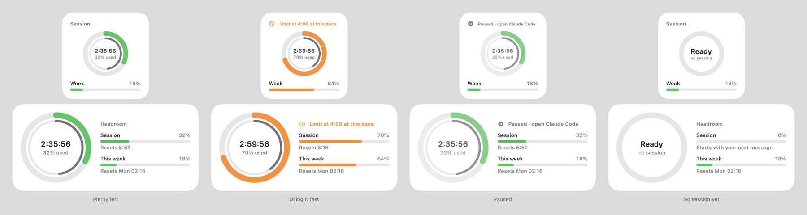

<p align="center"></p>

# Headroom

See how much of your Claude plan you have left, on your Mac's desktop and in
the menu bar: the time left in the current 5-hour session, how much of it you've
used, and how much of the weekly limit is gone.



The figures are the same ones Claude shows under **Settings → Usage**, so they
include everything you do in Claude Code, on claude.ai, and in the desktop and
mobile apps.

## What you get

- **A desktop widget**, small or medium. A ring shows how much of the session is
  used, with a live countdown to its reset inside; a bar shows the week. Green
  while there's room, orange past half, red near the limit. Click it to refresh.
- **Two rings.** The outer ring is how much of the session you've used; the thin
  inner one is how much of its 5 hours has passed, moving like a clock. When the
  outer ring is ahead, you're going faster than the time, and the widget says
  when you'd hit the limit at that pace, for example *Limit at 14:50 at this
  pace*. Otherwise it stays quiet.
- **A menu bar item:** a small ring that fills as the session is used, with the
  percentage or the time left next to it. Click it for the details, including
  the separate Opus and Sonnet weekly limits when your plan has them.
- **Settings** to hide the menu bar item, choose what it shows next to the icon
  (session used, time left, or nothing), set how often to check (every 1 to 15
  minutes), and start Headroom at login. With the menu bar item hidden, open Headroom again from
  Applications or Spotlight to get back to Settings.
- **Honest states.** When the figures can't be trusted, the widget says why:
  *Paused · open Claude Code* when Claude Code hasn't run for a while (see below),
  *Sign in to Claude Code*, *Offline*, or *Not updating*.

## Install

Download `Headroom.zip` from the releases page, unzip it, move **Headroom.app**
to Applications and open it. Or build it:

```bash
git clone https://github.com/romanhajas/headroom.git
cd headroom
./build.sh --install    # builds, installs to ~/Applications and starts it
```

Then add the widget: **right-click the desktop → Edit Widgets**, search for
**Headroom**, and drag it onto the desktop or into Notification Center.

Requirements: macOS 14 or later, and Claude Code installed and signed in with a
Claude subscription (Pro or Max). Building needs Xcode or the Command Line
Tools; the built app needs neither. It's a universal app for Apple silicon and
Intel.

Downloads are signed and notarized by Apple, so they open normally. The first
time Headroom reads Claude Code's sign-in, macOS may ask whether `security` may
use the keychain item *Claude Code-credentials*; choose **Always Allow**.

## How it works

- Every 3 minutes by default, and when you click the widget or wake the Mac, the app asks
  Anthropic's usage endpoint (`api.anthropic.com/api/oauth/usage`, the one behind
  Claude's usage page) for your figures. That call is read-only: it uses no
  tokens and doesn't start a session. When the server asks it to slow down, it
  backs off up to 30 minutes.
- It signs in with Claude Code's own sign-in, read from your login keychain
  through `/usr/bin/security`. The sign-in is never saved, logged or sent
  anywhere else.
- It saves only the figures, to
  `~/Library/Application Support/Headroom/limits.json`. The widget runs in
  macOS's sandbox and may read that one folder, nothing else.
- **Why "Paused"?** Claude Code's sign-in only lasts a few hours and Claude Code
  renews it whenever it runs. After a while without Claude Code, the server would
  refuse the old one, so Headroom waits instead of showing an error. Open Claude
  Code and it carries on by itself.
- It starts with your Mac (a login item, switchable in the menu bar popover).

## Good to know

- The usage endpoint isn't a documented API. Anthropic can change it at any
  time, and Headroom would then show *Couldn't read usage* until it's updated.
- Uninstall: quit Headroom from its menu, delete the app, and remove
  `~/Library/Application Support/Headroom`.
- **A personal badge:** put an SVG at `Support/Local/Badge.svg` before building
  and it shows small in the widget's corner. Add two poses, `Badge-walk-1.svg`
  and `Badge-walk-2.svg`, and it walks along the menu bar popover. That folder
  is git-ignored, so the images stay on your Mac.
- **Signed releases:** `./build.sh --release` signs with your Developer ID,
  notarizes and zips the app when `.signing.env` names your certificate and
  notarytool profile (see the top of `build.sh`). Without it, builds are signed
  ad-hoc, which is fine on your own Mac.
- The icon is drawn by `tools/make-icon.swift`.

Not affiliated with Anthropic. Claude is a trademark of Anthropic.

## License

MIT
